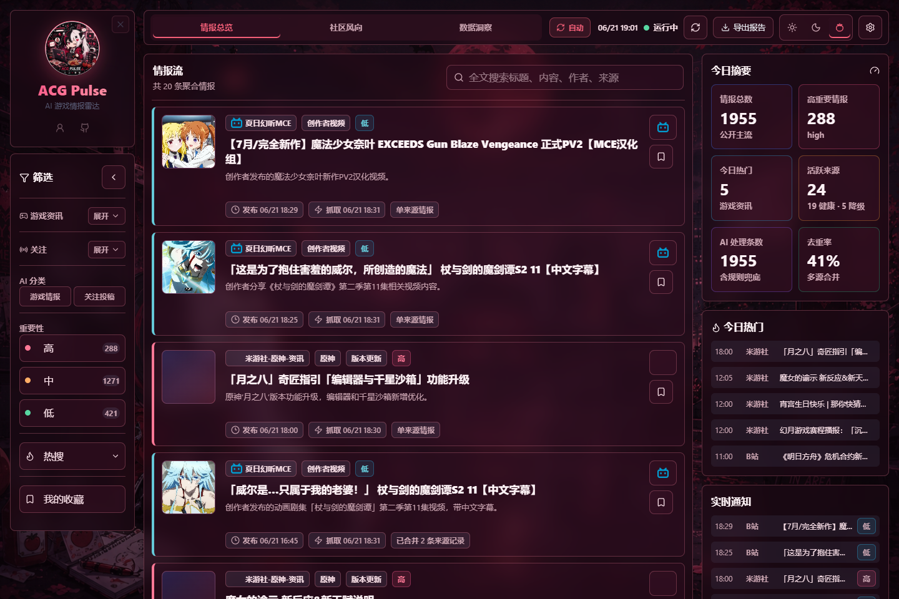
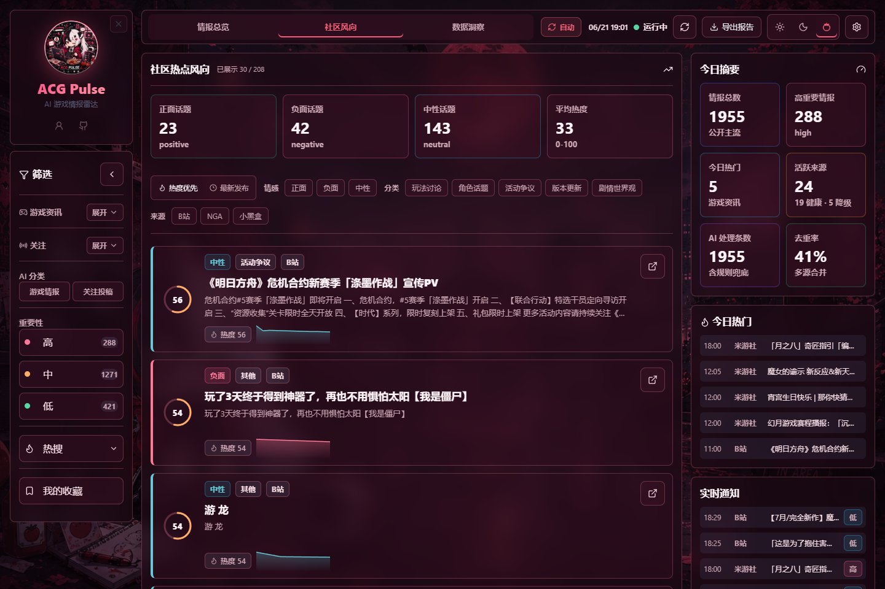
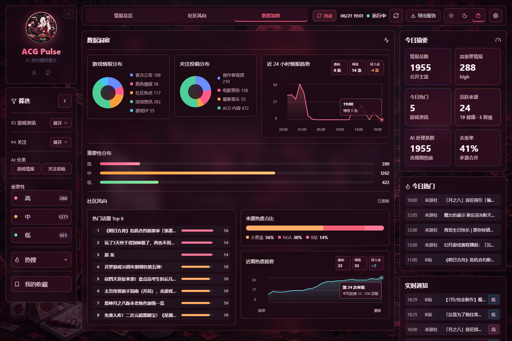
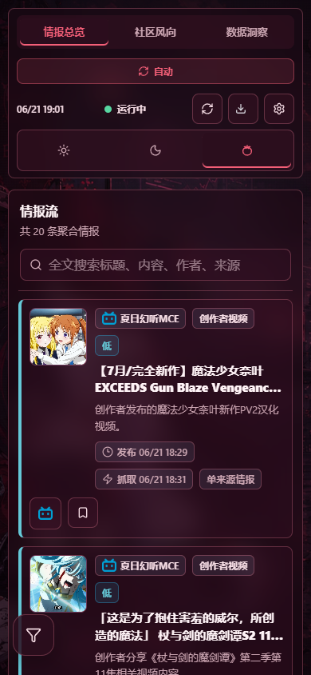
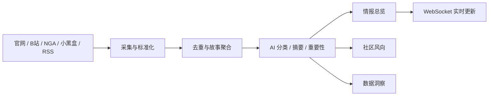

<div align="center">
  

  # ACG Pulse

  **AI 驱动的游戏与 ACG 情报聚合面板**

  从多源采集、故事聚合到社区风向与数据洞察，把分散资讯整理成可持续追踪的情报流。

  [项目复盘](docs/deployment-retrospective-2026-08-17.md) · [快速部署](#快速开始) · [部署文档](docs/deployment-guide.md) · [问题反馈](https://github.com/yingzhu77/ACG-Pulse/issues)

  [](https://github.com/yingzhu77/ACG-Pulse/actions/workflows/ci.yml)
  
  
  
</div>



> [!NOTE]
> 原公开演示已于 2026 年 8 月随生产服务器到期下线，旧域名不再提供服务。仓库保留完整源码、部署文档与生产复盘，可在本地或新服务器重新部署。

## 为什么做 ACG Pulse

游戏资讯散落在官网、社区、视频平台和 RSS 中。ACG Pulse 将这些来源统一采集，用 AI 完成分类、摘要和重要性判断，再按故事与话题组织，减少重复浏览和信息遗漏。

- **面向读者**：集中查看重要更新、热门话题和实时通知。
- **面向研究者**：比较来源占比、情绪变化和热度趋势。
- **面向维护者**：通过后台查看数据源健康、容量、API 延迟与分析队列。

## 核心能力

| 能力 | 说明 |
| --- | --- |
| 多源采集 | 聚合 B站、米游社、NGA、小黑盒、官网、RSSHub 等 24+ 数据源 |
| AI 分析 | 支持 OpenRouter、DeepSeek、Xiaomi MiMo，完成分类、摘要和重要性判断 |
| 故事聚合 | 将多来源重复内容合并为一个故事，同时保留原始出处 |
| 社区风向 | 提供情感、分类、来源筛选、数据时效，以及来源内归一化热度排序 |
| 数据洞察 | 展示情报分布、来源占比、热门话题和近期趋势 |
| 运维监控 | 监控容量、SQLite/WAL、API P95、错误率、数据源和分析队列 |

## 界面预览

| 社区风向 | 数据洞察 |
| --- | --- |
|  |  |

<div align="center">
  
  <p><sub>移动端响应式布局与快捷筛选入口</sub></p>
</div>

## 工作流程



## 技术栈

| 层级 | 技术 |
| --- | --- |
| 前端 | React 19、Vite 7、Tailwind CSS 4、Framer Motion、Lucide |
| 后端 | Node.js、Express 5、Prisma、SQLite、Socket.IO |
| AI | OpenRouter、DeepSeek、Xiaomi MiMo |
| 采集 | RSSHub、Axios、Cheerio、Playwright Chromium |
| 部署 | Docker Compose |

## 快速开始

### Docker Compose（推荐）

要求：Git、Docker 与 Docker Compose。

```bash
git clone https://github.com/yingzhu77/ACG-Pulse.git
cd ACG-Pulse

cp .env.production.example .env
```

编辑 `.env`，至少设置：

```dotenv
AI_PROVIDER=deepseek
DEEPSEEK_API_KEY=your_api_key
DEEPSEEK_MODEL=deepseek-v4-flash
ADMIN_PASSWORD=your_strong_password
ADMIN_JWT_SECRET=your_random_secret_at_least_32_chars
CLIENT_URL=https://your-domain.example
TRUST_PROXY_HOPS=1
BILIBILI_COOKIE=your_bilibili_login_cookie
```

检查配置并启动：

```bash
bash scripts/check-config.sh .env
docker compose up -d --build
```

`docker compose up` 会同时启动应用和自建 RSSHub。B站主路径由自建 RSSHub 承担；根目录 `.env` 中的 `BILIBILI_COOKIE` 会被 Compose 映射为 RSSHub 需要的 per-uid Cookie，应用容器默认不接收该 Cookie，直连 API 备用默认关闭。

配置 Caddy 或其他 HTTPS 反向代理后，访问 `CLIENT_URL` 对应的地址。

### B站采集路径

- **主路径**：Compose 内置 `rsshub` 服务（自定义镜像，含 Chromium），`RSSHUB_BASE_URLS` 默认自建实例优先、公共实例最后回退。
- **Cookie 归属**：登录 Cookie 只放在根目录 `.env` 的 `BILIBILI_COOKIE`；Compose 映射为 `BILIBILI_COOKIE_<uid>` 供 RSSHub 使用。
- **直连备用**：`BILIBILI_DIRECT_API_FALLBACK=false` 默认关闭；仅在显式设为 `true` 或单个源配置 `directApiFallback=true` 时启用。
- **辅助直连**：头像补全（`fetchBilibiliAvatar`）仍匿名请求 B站 `acc/info`，失败只记日志，不影响采集。
- **快速验证**：`docker exec game-pulse-rsshub curl -fsS --max-time 20 http://localhost:1200/bilibili/user/video/401742377 | head -c 200` 应返回 RSS XML，而不是 503/403 错误页。
- **后台预览**：`POST /api/admin/sources/preview` 默认超时 30s，可用 `SOURCE_PREVIEW_TIMEOUT_MS` 调整（最低 5s）；预览允许空 `game` 并以“通用”展示，但创建/更新源仍要求非空。预览失败不等于采集失败，以实际 check 和源健康为准。
- **更新 Cookie**：在 Windows 上直接运行 `scripts\set-bilibili-cookie.cmd`（或先复制 Cookie 再运行 `scripts\set-bilibili-cookie.cmd --from-clipboard`）。脚本会隐藏输入或读取剪贴板，先调用 B站 nav 接口校验登录态，再原子更新根目录 `.env`、重建 RSSHub，并检查容器内登录态和一条 B站路由；Cookie 不会打印到终端。建议先退出 B站账号重新登录，确保拿到的是新鲜 Cookie。

### 本地开发

先启动本地 RSSHub（独立开发 Compose，发布 1200 端口）：

```bash
docker compose -f docker-compose.rsshub.yml up -d rsshub
```

该文件使用根目录 `.env` 中的 `BILIBILI_COOKIE`，也允许用 `BILIBILI_COOKIE_<uid>` 覆盖单个 UID；`server/.env` 只配置 `RSSHUB_BASE_URLS`，不要把 Cookie 复制到后端环境文件。

分别启动后端和前端：

```bash
cd server
npm install
PORT=3002 ADMIN_PASSWORD=local-dev ADMIN_JWT_SECRET=local-dev-secret-at-least-32-characters npm run dev
```

```bash
cd client
npm install
npm run dev
```

访问 [http://localhost:5173](http://localhost:5173)。

## 常用配置

| 变量 | 是否必填 | 用途 |
| --- | --- | --- |
| `AI_PROVIDER` | 是 | `openrouter`、`deepseek` 或 `mimo`；生产默认 `deepseek` |
| Provider API Key | 是 | 与所选 Provider 对应的密钥；默认使用 `DEEPSEEK_API_KEY` |
| `DEEPSEEK_MODEL` | 否 | DeepSeek 模型名，默认 `deepseek-v4-flash` |
| `ADMIN_PASSWORD` | 是 | 管理后台登录密码 |
| `ADMIN_JWT_SECRET` | 是 | 管理令牌签名密钥，至少 32 字符 |
| `CLIENT_URL` | 是 | 允许访问 API 的前端 Origin |
| `BILIBILI_COOKIE` | 建议 | 根目录 `.env` 中的 B站登录 Cookie，供自建 RSSHub 使用 |
| `BILIBILI_DIRECT_API_FALLBACK` | 否 | 是否启用直连 API 备用，默认 `false` |
| `RSSHUB_BASE_URLS` | 否 | RSSHub 实例列表，默认自建实例优先 |
| `MAX_FEED_ITEMS` | 否 | 情报保留上限，默认 2000 |
| `ANALYSIS_TASK_COMPLETED_RETENTION_DAYS` | 否 | 成功分析任务历史保留天数，默认 14 |
| `ANALYSIS_TASK_FAILED_RETENTION_DAYS` | 否 | 终态失败分析任务历史保留天数，默认 30 |
| `REPORT_TIMEZONE` | 否 | 日报/周报日期边界时区，默认 `Asia/Shanghai` |

完整配置参见 [.env.production.example](.env.production.example)。不要提交真实密码、API Key 或 Cookie。

## 验证

```bash
cd server && npm test && npm run build
cd ../client && npm run lint && npm run build
```

CI 会在推送和 Pull Request 时运行项目验证。

## 文档导航

| 文档 | 用途 |
| --- | --- |
| [部署指南](docs/deployment-guide.md) | 生产部署、反向代理、更新流程与排障速查 |
| [API 契约](docs/API_CONTRACTS.md) | 接口语义、共享 DTO 与变更检查清单 |
| [Agent 协作手册](docs/AGENT_WORKFLOW.md) | 任务输入、开发流程、验证与提交规范 |
| [路线图](docs/ROADMAP.md) | 当前阶段和后续方向 |
| [跨窗口交接](docs/NEXT_WINDOW_PROMPTS.md) | 当前事实、剩余任务和下个窗口提示词 |
| [踩坑记录](docs/LESSONS.md) | 已验证的问题模式、根因和处理规则 |
| [架构决策](docs/DECISIONS.md) | 长期技术选择及变更入口 |
| [采集优化与验收记录](docs/collection-optimization-2026-10-19.md) | 2026-10-19/20 采集修复、真实源验收与 B站主路径切换 |
| [生产部署复盘（历史归档）](docs/deployment-retrospective-2026-08-17.md) | 实例到期、故障归因与迁移恢复记录 |
| [项目案例与简历素材](docs/resume-project-case-study.md) | 简历条目、面试表达与可验证项目指标 |

## 项目结构

```text
client/                 React 前端
server/                 Express API、采集、AI 与数据库
shared/                 前后端共享类型
rsshub/                 RSSHub 浏览器运行环境
scripts/                配置检查、备份与维护脚本
docs/                   部署、协作、决策与项目记录
```

## 参与贡献

欢迎通过 Issue 报告问题或提出建议。提交代码前请阅读 [CONTRIBUTING.md](CONTRIBUTING.md)，安全问题请按 [SECURITY.md](SECURITY.md) 私下报告，不要直接创建公开 Issue。

## 致谢

- 项目早期基于 [liyupi/yupi-hot-monitor](https://github.com/liyupi/yupi-hot-monitor) 改造，感谢原作者提供的基础思路与实现
- [DIYgod/RSSHub](https://github.com/DIYgod/RSSHub)：RSS 路由与内容聚合基础设施
